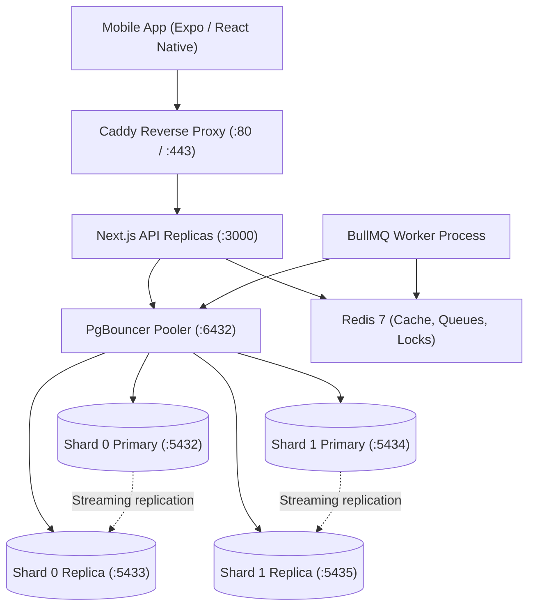

# Rota

Rota is a mobile shift scheduling app for clinics and other shift-based teams such as restaurants. Owners run billing for a team. Managers build the schedule as a draft, publish it, invite staff and approve swaps. Staff see their shifts across all their teams, set weekly availability, request swaps, read their schedule offline and get push notifications that respect their quiet hours.

## Architecture

Rota runs a monorepo built with pnpm workspaces:

- `apps/mobile`: React Native app built with Expo SDK, TanStack Query, Zustand, and expo-secure-store.
- `apps/api`: Next.js App Router API standalone application running on Node 22 LTS with Prisma 6, PgBouncer, and Redis.
- `packages/shared`: Shared TypeScript domain models, Zod validation schemas, error types, and enums.
- `infra/`: Docker Compose orchestration running PostgreSQL 16 (2 shards with read replicas), PgBouncer connection pooler, Redis 7, Caddy TLS reverse proxy, and BullMQ worker.



## System Design Highlights

- **Connection Pooling**: Transaction-mode PgBouncer handling up to 1,000 client connections with 20 pooled server connections.
- **Sharding**: Two independent PostgreSQL shards partitioned by `hash(team_id) % 2` with dedicated tenant routing.
- **Read Replicas & Read-Your-Own-Writes**: Query replication routing via `@prisma/extension-read-replicas` with a 5-second RYOW window following client writes.
- **Append-Only Ledger**: Immutable billing ledger protected by PostgreSQL triggers preventing `UPDATE`, `DELETE`, and `TRUNCATE`.
- **Background Jobs**: BullMQ queues for notifications, webhook processing, quiet-hours compliance, and periodic syncs.

## Local Development Setup

### 1. Requirements

- Node.js 22 LTS
- pnpm 9+
- Docker & Docker Compose

### 2. Environment Configuration

Copy the environment template:

```bash
cp .env.example .env
```

### 3. Start Infrastructure

```bash
cd infra
docker compose up -d
```

### 4. Install & Run

```bash
pnpm install
pnpm --filter api exec prisma generate
pnpm dev
```
