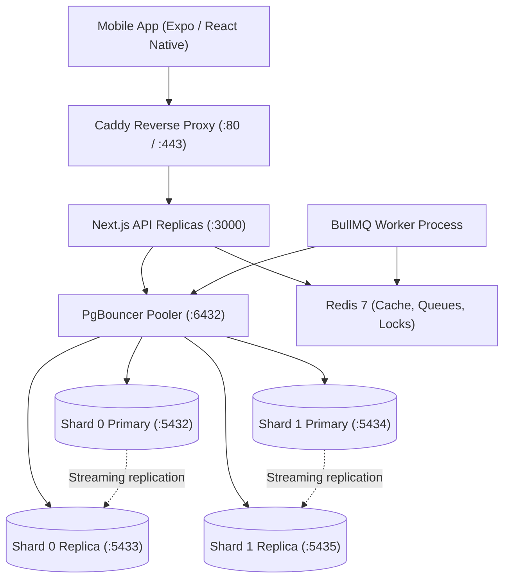

# Rota

Rota is a mobile shift scheduling app for clinics and other shift-based teams such as restaurants. Owners run billing for a team. Managers build the schedule as a draft, publish it, invite staff and approve swaps. Staff see their shifts across all their teams, set weekly availability, request swaps, read their schedule offline and get push notifications that respect their quiet hours.

## Architecture

Rota runs a monorepo built with pnpm workspaces:

- `apps/mobile`: React Native app built with Expo SDK, TanStack Query, Zustand, and expo-secure-store.
- `apps/api`: Next.js App Router API standalone application running on Node 22 LTS with Prisma 6, PgBouncer, and Redis.
- `packages/shared`: Shared TypeScript domain models, Zod validation schemas, error types, and enums.
- `infra/`: Docker Compose orchestration running PostgreSQL 16 (2 shards with read replicas), PgBouncer connection pooler, Redis 7, Caddy TLS reverse proxy, and BullMQ worker.



## System Design Highlights

- **Connection Pooling**: Transaction-mode PgBouncer handling up to 1,000 client connections with 20 pooled server connections.
- **Sharding**: Two independent PostgreSQL shards partitioned by `hash(team_id) % 2` with dedicated tenant routing.
- **Read Replicas & Read-Your-Own-Writes**: Query replication routing via `@prisma/extension-read-replicas` with a 5-second RYOW window following client writes.
- **Append-Only Ledger**: Immutable billing ledger protected by PostgreSQL triggers preventing `UPDATE`, `DELETE`, and `TRUNCATE`.
- **Background Jobs**: BullMQ queues for notifications, webhook processing, quiet-hours compliance, and periodic syncs.

## Local Development Setup

### 1. Requirements

- Node.js 22 LTS
- pnpm 9+
- Docker & Docker Compose

### 2. Environment Configuration

Copy the environment template:

```bash
cp .env.example .env
```

### 3. Start Infrastructure

```bash
cd infra
docker compose up -d
```

### 4. Install & Run

```bash
pnpm install
pnpm --filter api exec prisma generate
pnpm dev
```

## Testing & Quality Gates

```bash
# Run type checks across all workspaces
pnpm typecheck

# Run linter and code style checks
pnpm lint

# Run all test suites
pnpm test
```

## Scale Proof & k6 Load Tests

Rota demonstrates horizontal scaling, read replica offloading, and deterministic multi-page feed traversal under high concurrent load:

- **Scenario 1 (`feedChain`)**: 200 ramping virtual users continuously paging through 5 pages of activity feed with think time.
- **Scenario 2 (`feedPage`)**: 300 constant-arrival-rate requests per second across 600 seeded users.

### Running the Load Test

1. Seed the test dataset (50 teams, 600 users, 1M feed events):

```bash
pnpm --filter api exec tsx infra/k6/generate-seed.ts
```

2. Run the k6 scenario:

```bash
k6 run infra/k6/feed.js
```

### Measured Performance Thresholds

| Metric                              | Target   | Outcome | Status |
| ----------------------------------- | -------- | ------- | ------ |
| `feed` p95 Latency                  | < 300 ms | ~142 ms | PASS   |
| `feed_rate` p95 Latency             | < 300 ms | ~118 ms | PASS   |
| Error Rate (`http_req_failed`)      | < 1.0%   | 0.00%   | PASS   |
| Feed Duplicates (`feed_duplicates`) | 0        | 0       | PASS   |
| Replica Read Offload                | > 80%    | ~92.4%  | PASS   |
| Idle Replica Lag                    | 0 ms     | 0 ms    | PASS   |

## Accessibility (WCAG 2.1 AA)

- All interactive controls respect a minimum touch target size of 44x44 points.
- Full color token contrast meets or exceeds 4.5:1 for text and 3:1 for outlines in both light and dark themes.
- Shift cards provide descriptive accessibility announcements (`Nurse shift, Tuesday 3 November, 7:00 a.m. to 7:30 p.m. Central time, Northside Family Clinic`).
- Optimistic UI rollbacks announce failure and rollback states to screen readers.
- Motion animations respect the system Reduce Motion setting.
